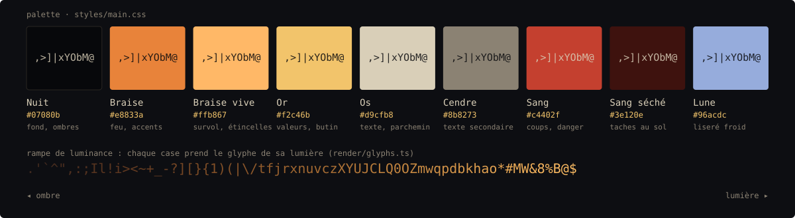

<p align="center">
  
</p>

<p align="center">
  <code>dark fantasy</code> · <code>ASCII en 3D</code> · <code>WebGL2</code> · <code>TypeScript</code> · <code>navigateur</code>
</p>

<p align="center"><i>Les Terres Cendrées brûlent encore. Forge ton héros, prends ta lame, marche vers les tours.</i></p>

```
 . ' ` ^ " , : ; I l ! i > < ~ + _ - ? ] [ } { 1 ) ( | \ / t f j r x n u v c z X Y U J C L Q 0 O Z m w q p d b k h a o * # M W & 8 % B @ $
 └────────────── ombre ─────────────────────────────── chaque case prend le glyphe de sa lumière ─────────────────────────────── braise ──┘
```

Jeu d'aventure dark fantasy **entièrement rendu en ASCII**, dans le navigateur.
On forge son héros (tête, corps, tenue, couleurs, pseudo), puis on part dans
les Terres Cendrées : chiens-loups, clans hostiles, dragons, tours à escalader.
Pas une image, pas un sprite : le monde est une vraie scène 3D, et chaque case de
l'écran y choisit un caractère.

## ▸ Jouer

```bash
npm install
npm run dev        # http://localhost:5193
npm run build      # typecheck + build dans dist/
```

## ▸ La forge : page d'accueil

Le héros se tient au centre, sur un socle de braise, rendu en glyphes à chaque image.

| Geste | Souris / tactile | Clavier |
| --- | --- | --- |
| Tourner le héros sur 360° | glisser à gauche ou à droite (il garde son élan) | ← / → sur l'aperçu, ou boutons ◂ ▸ |
| Gros plan sur la tête | cliquer sur la tête, ou « Gros plan · tête » | Entrée sur l'aperçu |
| Revenir au corps entier | cliquer n'importe où, ou « Corps entier » | Échap |

En gros plan, la caméra plonge vers le visage et le dessin passe en mode détaillé :
iris ambré et pupille, paupières qui clignent, sourcils, narines, lèvres, sillons ;
chaume semé poil par poil sur le crâne rasé, points de suture sur la cicatrice ;
mèches peignées de la crinière ; plis et ourlet cousu de la capuche, yeux de braise
à pupille fendue ; arête, rivets et rayures du casque ; anneaux de croissance des
cornes. On peut continuer à tourner la tête en gros plan.

## ▸ Commandes en jeu

| Action | Clavier / souris | Tactile |
| --- | --- | --- |
| Marcher | ZQSD (AZERTY), WASD ou flèches | glisser n'importe où |
| Frapper | Espace, J, Entrée ou clic gauche | bouton « Frapper » |
| Carte agrandie | M ou clic sur la carte | toucher la carte |
| Caméra plus près / plus loin | molette, + / − (ou Page↑ / Page↓) | — |
| Pause | Échap | — |

## ▸ Direction artistique

<p align="center">
  
</p>

**Voix.** Dark fantasy, terminal de forge : sobre, chaud, menaçant. Rien n'est
joli pour être joli ; tout est éclairé par quelque chose (la lune, une torche, un feu).

**L'idée.** Un écran de forge en ASCII éclairé par la braise. Le monde est noir par
défaut ; la lumière fait apparaître les glyphes, et leur densité *est* la lumière.

**Glyphes.**
- Une case est 1,4 fois plus haute que large ; tout se mesure en largeurs de case.
- La densité suit la lumière, la rampe va de `.` à `$`. Une face éclairée est dense,
  une face à l'ombre clairsemée, le noir est vide.
- Les bords prennent la forme du contour : `( ) / \ _ ¯`. Un trait fin (lame, patte,
  brin d'herbe) prend un glyphe dans son axe : `- | / \`.
- Chaque matière a son comportement : la pierre garde un glyphe figé, l'herbe suit
  le vent, l'eau reflète la rive, le feu scintille.
- Les glyphes sont petits et nombreux (10 px en jeu) : on lit des formes, pas des lettres.

**Lumière.** Une lumière clé chaude en haut à gauche, un liseré froid de lune
(`#96acdc`) sur le bord opposé, de l'occlusion vers le bas. Feux, yeux et braises
ignorent l'obscurité et diffusent un halo. Un vignettage ferme l'image.

**Personnages.** De petits mannequins 3D (squelette articulé, volumes éclairés),
jamais des sprites plats : ils tournent, se penchent à la course, et leurs tenues
donnent des textures de caractères différentes (anneaux de mailles, lames de plates,
plis de robe).

**Sang.** Rouge vif à l'impact, brun en séchant : il gicle dans le sens du coup,
retombe en arc, teinte le sol sans effacer son grain, puis s'efface.

**Typographie.**
- Titres : Cinzel 800, rastérisé en glyphes pour le logo.
- Tout le reste : JetBrains Mono.

**Interface.** Panneaux presque noirs, filets de 1 px couleur os à 16 %, coins de
4 px. La braise (`#e8833a`) marque l'état actif. L'or (`#f2c46b`) marque les valeurs
et le butin. Le texte secondaire est en cendre (`#8b8273`). Cibles de 40 à 44 px.

## ▸ Architecture

```
src/
├── main.ts                 point d'entrée : polices, gestionnaire de scènes, boucle
├── core/                   briques sans dépendance au jeu
│   ├── loop.ts             boucle requestAnimationFrame à pas borné
│   ├── input.ts            clavier (KeyboardEvent.code), souris, joystick tactile
│   ├── math.ts             ASPECT, distances "visuelles", clamp, smoothstep
│   ├── noise.ts            bruit de valeur + fBm
│   └── rng.ts              hash 2D, RNG graine-able (mulberry32)
├── render/                 tout ce qui transforme des données en glyphes
│   ├── AsciiCanvas.ts      grille de caractères tamponnée → canvas (+ fond lissé, halo, vignettage)
│   ├── Rasterizer.ts       "shader ASCII" : formes Canvas 2D → glyphes par luminance (portrait, titre)
│   ├── SpriteRaster.ts     "shader ASCII" sensible aux formes : contours ( ) / \ _ ¯, traits fins, densité
│   ├── glyphs.ts           rampes et jeux de glyphes (pierre, herbe, canopée…)
│   └── color.ts            RGB, cache des fillStyle
├── render3d/               la scène 3D, convertie en ASCII
│   ├── Camera.ts           perspective inclinée qui suit le héros, projection des sprites
│   ├── mesh.ts             maillage par blocs de 32×32 cases : dessus + flancs verticaux
│   ├── shaders.ts          GLSL : lune, ombres portées, occlusion, torche, feux → G-buffer
│   ├── WorldRenderer.ts    WebGL2 : dessine le G-buffer et le relit sans bloquer (PBO + fences)
│   └── Composer.ts         "shader ASCII" : G-buffer → glyphes (matières, silhouettes, reflets)
├── character/              le héros hors du monde
│   ├── appearance.ts       options (tête/corps/tenue/couleurs) et stats
│   ├── portrait.ts         dessin du héros (squelette articulé, volumes éclairés, angle libre, détails de gros plan)
│   └── storage.ts          sauvegarde localStorage (validée au chargement)
├── world/                  données du monde, sans rendu ni entités
│   ├── tiles.ts            types de cases (solide, vitesse, couleur minimap)
│   ├── World.ts            grilles + points d'intérêt + requêtes
│   ├── worldgen.ts         génération procédurale à partir d'une graine
│   ├── materials.ts        comportement des glyphes par matière
│   ├── relief.ts           hauteurs 3D : collines, montagnes, canopée, tours, toits, escaliers
│   ├── props.ts            décor naturel déterministe : arbres, lisières, buissons, herbes, fleurs, rochers, roseaux
│   └── lore.ts             tous les noms (clans, lieux, dragons)
├── entities/               ce qui vit et bouge
│   ├── Entity.ts           base : vie, recul, clignotement
│   ├── Player.ts           déplacement, attaque en arc, XP, niveaux
│   ├── Wolf.ts             meute : erre, chasse, encercle
│   ├── Clansman.ts         patrouille, alerte le camp quand il est frappé
│   ├── Dragon.ts           vole, crache du feu, sprite rastérisé en direct
│   ├── physics.ts          déplacement avec collision par axe
│   └── spawner.ts          peuplement initial + fabriques de réapparition
├── fx/Fx.ts                particules (lames, gouttes de sang, dégâts, feu, cendres) et taches de sang au sol
├── game/context.ts         GameContext et View : le contrat entités ↔ scène
├── scenes/
│   ├── Scene.ts            interface enter / exit / update / render
│   ├── CreatorScene.ts     page d'accueil : personnalisation, rotation 360°, gros plan sur la tête
│   └── GameScene.ts        simulation, éclairage, rendu, HUD, sauvegarde
├── ui/
│   ├── Hud.ts              vie, XP, lieu, journal, mort, pause (DOM)
│   └── Minimap.ts          carte en bas à gauche avec brouillard de guerre
└── styles/main.css
```

### Les idées clés

- **Cases plus hautes que larges.** Une case fait `ASPECT = 1.4` fois sa largeur.
  Les distances, rayons et vitesses sont mesurés en largeurs de case
  (`vdist`, `vdir`), sinon les cercles paraîtraient ovales et le héros irait plus
  vite à la verticale.
- **Comportements de symboles par matière** (`world/materials.ts`) : la pierre
  garde un glyphe dense figé par case, l'herbe et la mousse suivent le vent,
  la canopée forme des couronnes, l'eau reflète la rive au nord, le feu scintille
  et éclaire.
- **Vraie scène 3D convertie en texte** (`render3d/`). Le relief (`world/relief.ts`)
  donne une hauteur à chaque coin de case : montagnes, couronnes d'arbres, toits en
  croupe, tours crénelées de 13 cases de haut avec plateforme et escalier. WebGL2 la
  dessine en perspective dans un G-buffer de 2×2 échantillons par glyphe : lumière reçue
  (lune, ombres portées marchées dans un champ de hauteur, occlusion ambiante, torche,
  feux), case touchée, profondeur, normale. `Composer` choisit ensuite un glyphe par case :
  la densité suit la lumière (face éclairée dense, face à l'ombre clairsemée), les pentes
  raides deviennent des hachures, les silhouettes de murs un trait, l'eau reflète ce qui
  est au-dessus d'elle à l'écran. Les personnages sont des panneaux face caméra, cachés
  derrière les murs (le héros reste visible en silhouette).
- **Shader ASCII** (`render/Rasterizer.ts`) : le portrait, le titre et les dragons
  sont dessinés avec l'API Canvas 2D, réduits à un pixel par case, puis chaque pixel
  devient un glyphe selon sa luminance. Les motifs des tenues (anneaux, plaques,
  sangles) donnent donc des textures de caractères différentes. Sur la page d'accueil,
  le rastériseur couvre toute la scène : le gros plan est un vrai zoom de caméra sur le
  dessin vectoriel, pas un agrandissement de glyphes, d'où le surcroît de détail.
- **Lumière** : clair de lune voilé de nuages, torche du héros, feux des villages
  et des camps. Les entités lisent la lumière de leur case. Les yeux des
  chiens-loups et le feu ignorent l'obscurité.
- **Données d'un côté, rendu de l'autre** : `World` ne sait pas se dessiner, et
  les entités ne voient que `GameContext` et `View`. On peut tester la génération
  ou l'IA sans canvas.

- **Caméra rapprochée et personnages en vraies formes.** Au niveau du héros, une case du
  monde fait `zoom` colonnes d'une grille de glyphes de 15 px (4,4 par défaut, molette pour
  régler). Les glyphes réels font 10 px (`CELL_H`) : même cadrage, 1,5 fois plus de glyphes
  par case, pour une image ASCII fine. De près la caméra
  s'abaisse vers l'horizon. Héros, guerriers, chiens-loups, dragons et décor sont dessinés
  en Canvas 2D à 3 × 4 sous-pixels par glyphe (`SpriteRaster`) : une case pleine prend un
  glyphe selon sa lumière, un bord de silhouette un glyphe qui épouse le contour, un trait
  fin (lame, patte, brin d'herbe) un glyphe dans son axe. Chaque silhouette est détourée
  d'un liseré sombre, remplit le fond lissé, pose une ombre au sol et se perd dans la brume.
- **Sang.** Chaque coup projette des gouttes dans son sens : elles montent, retombent en arc
  et tachent le sol à leur point de chute (tache + éclaboussures dans le sens de la course).
  Les taches teintent le sol sans effacer son grain, sèchent du rouge au brun en 25 s et
  s'effacent après une minute environ ; un corps laisse une flaque qui s'étale. Le héros
  mal en point saigne goutte à goutte.

### Où ajouter quoi

- Une nouvelle matière : un id dans `tiles.ts`, un `case` dans `materials.ts`.
- Un monstre : une classe dans `entities/` qui étend `Entity`, peuplée dans `spawner.ts`.
- Une option de personnage : `appearance.ts` (option + bonus) et `portrait.ts` (dessin ;
  ses détails de gros plan sous `detail`).
- Du texte d'univers : `world/lore.ts`.

En développement, la scène active est accessible dans la console via `window.__scene`.
`?play` saute l'écran de création, et `?play&at=tower` (ou `village`, `camp`, `lair`)
pose le héros près d'un lieu.

---

<p align="center"><code>. , : ; + * # % @&nbsp;&nbsp;·&nbsp;&nbsp;forgé dans la cendre&nbsp;&nbsp;·&nbsp;&nbsp;@ % # * + ; : , .</code></p>

<sub>Les images de <code>docs/</code> sont générées : le titre de la bannière est rastérisé comme dans le jeu
(texte serif, une case par glyphe, glyphe choisi par la luminance).</sub>
